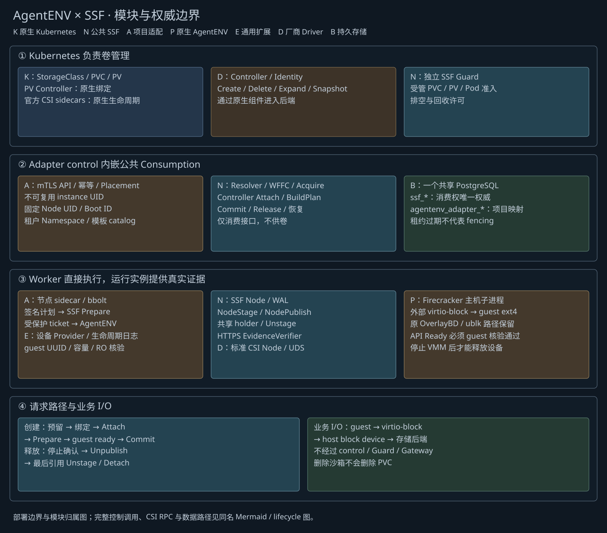
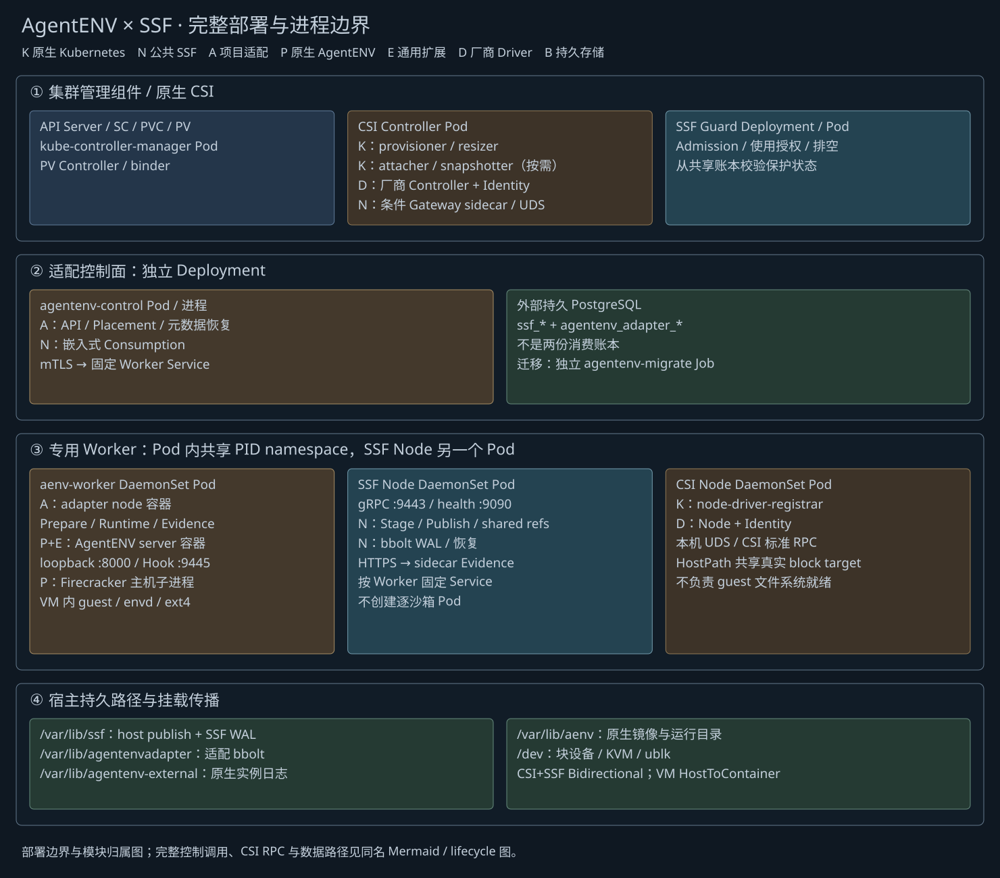
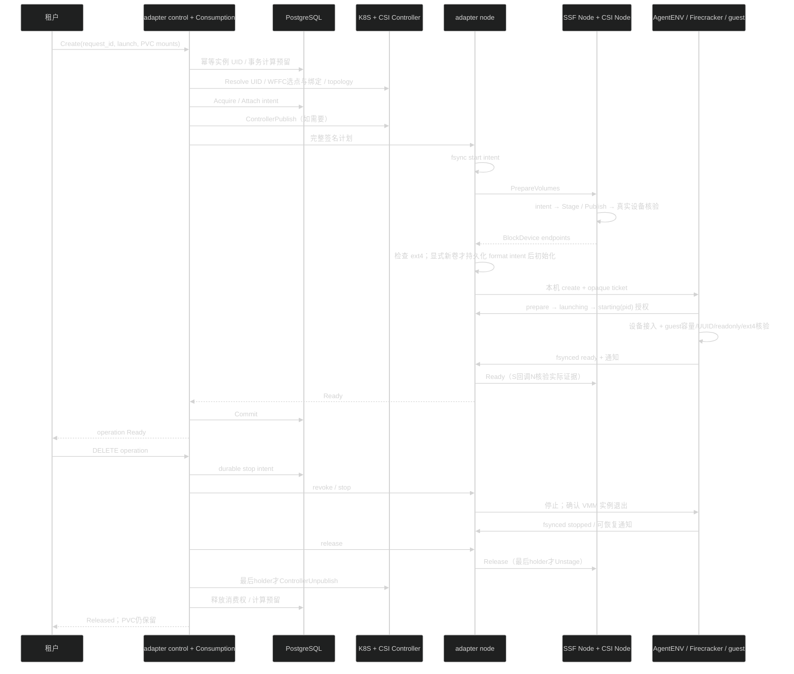

# AgentENV 对接 SSF：设计、实现与验收记录

更新时间：2026-10-19。适配工程位于 [SSF/adapter/agentenvadapter](../SSF/adapter/agentenvadapter/README.md)。AgentENV 基线为 `v0.2.3` / `6cccaa7842bd5be2051111d4f74d9e37aa721244`。

首次安装见 [端到端安装部署手册](13-agentenvadapter-installation-and-deployment.md)，包含分阶段清单、证书与数据库、模板构建、真实读写验收及运维流程。

本轮已经交付适配控制面、节点 sidecar、Runtime/Evidence 实现、AgentENV 通用扩展、部署渲染器、客户端、测试和可重放补丁。**当前是实现交付，尚未完成真实 AgentENV/Firecracker 端到端验收。** macOS 已运行 Go 测试、race、静态检查、Linux 交叉构建和补丁重放；Rust 类型检查、Linux 原生构建、PostgreSQL/Kubernetes/VM 实跑仍待执行，不能据此宣称可生产使用或承诺启动延迟。

## 1. 范围与代码边界

新增 CSI **Block** 卷，guest 文件系统限 ext4。冷启动与模板启动共用外部设备 Provider。原有 OverlayBD/ublk 镜像、rootfs、内存快照及 AgentENV 原生卷继续走原实现；适配器不接管其生命周期。

带外部卷的暂停恢复、快照、fork、在线扩容、FileTree 不开放。适配 API 不接受原生 `volumeMounts`、`attachedDrives`、`customExtensionParams`，禁止同时走两套消费路径。原生扩展也在生命周期入口和 VMM 边界拒绝这些操作。未配置扩展的普通 AgentENV 路径保持原默认逻辑，但 Linux 回归尚未实跑。

| 层次 | 目录 / 内容 | 依赖与修改 |
| --- | --- | --- |
| SSF 公共核心 | consume、ledger、node、kubernetes、runtime 等 | 不导入 AgentENV 或适配包；本轮仅补通用静态拓扑选择与计划下发前补偿能力 |
| 项目适配工程 | [agentenvadapter](../SSF/adapter/agentenvadapter/) | 依赖公共 SSF API；API、配置、选点、授权、状态、部署及测试集中于此 |
| AgentENV 通用扩展 | custom_extension/storage、Firecracker、配置、manifest、生命周期入口 | 修改 6 个已有 Rust 文件，新增 1 个模块；无 PVC/CSI/SSF 账本依赖 |
| 其他项目 | CubeSandbox、Substrate | 本轮不修改；没有 CubeSandbox adapter |

没有新增强制 SSF Controller。`agentenvadapter control` 是项目适配服务，内嵌公共 Consumption；节点 `agentenvadapter node` 是 AgentENV Pod sidecar。SSF Node、Guard 和条件 Gateway 保持公共职责。

## 2. 模块及部署



[模块图 Mermaid](figures/agentenvadapter-modules.mmd) · [PNG](figures/agentenvadapter-modules.png) 包含控制调用、CSI RPC 和业务 I/O；SVG 着重模块归属。K=原生 Kubernetes，N=公共 SSF，A=适配实现，P=原生 AgentENV，E=AgentENV 通用扩展，D=厂商 Driver，B=持久存储。图源与导出脚本均可编辑，沿用既有低饱和深色分层风格。



[部署图 Mermaid](figures/agentenvadapter-deployment.mmd) · [PNG](figures/agentenvadapter-deployment.png) · [创建/释放时序图源](figures/agentenvadapter-lifecycle.mmd) · [部署操作说明](../SSF/adapter/agentenvadapter/deploy/README.md)

| 部署单元 | 子模块 | 来源 |
| --- | --- | --- |
| kube-controller-manager Pod | PV Controller、binder | K，原生 |
| 厂商 CSI Controller Pod | Controller/Identity；provisioner/attacher/resizer/snapshotter 按需；条件 Gateway sidecar | D + K + N |
| SSF Guard Deployment | webhook、消费冲突、排空及删除许可校验 | N，公共 |
| agentenv-control Deployment | mTLS API、幂等映射、Placement、模板 catalog、恢复；内嵌 Consumption | A + N |
| 外部 PostgreSQL | ssf_* 消费权唯一账本；agentenv_adapter_* 项目元数据 | 持久服务；不是双重消费权威 |
| 每 Worker 的 aenv-worker DaemonSet Pod | AgentENV server 容器 + adapter node 容器，共享 PID namespace | P/E + A |
| AgentENV 容器中的主机子进程 | Firecracker；原 OverlayBD/ublk 相关进程 | P；不是逐沙箱 Pod |
| 每 Worker 的 SSF Node DaemonSet Pod | gRPC、Stage/Publish、共享引用、bbolt WAL、HTTPS EvidenceVerifier | N |
| 厂商 CSI Node DaemonSet Pod | Node/Identity、UDS、node-driver-registrar | D + K |
| VM guest | envd、virtio-block、ext4、实际业务进程 | P；guest 检查由 E 执行 |
| 一次性 agentenv-migrate Job | SSF 与适配表 SQL 迁移 | N + A |

每个 Worker 使用确定的 Service 和对应 TLS DNS SAN；不使用可能转发到其他节点的统一节点 Service。渲染器按 Node metadata.name 生成 affinity。容量是运营方划给沙箱的专用额度，不能把物理总容量全部填入。节点池禁止普通 AgentENV Gateway 再次调度；未接入通用启动授权的请求会在启动设备规划前被拒绝。

原生 API 只监听 `127.0.0.1:8000`，Hook 只监听 `127.0.0.1:9445`。控制面与 sidecar、SSF Node、Gateway 均使用 mTLS；证书 URI 分角色列入白名单。用户访问独立 API，经 Namespace 授权使用 PVC。具有特权 Pod exec 权限的运维人员属于可信控制域，不能向普通租户授予该权限。

## 3. 实现文件映射

| 能力 | 文件 |
| --- | --- |
| API、请求校验、设备与事件契约 | [types.go](../SSF/adapter/agentenvadapter/types.go)、[OpenAPI](../SSF/adapter/agentenvadapter/api/openapi.json) |
| HTTP/mTLS、角色身份与配置 | [http.go](../SSF/adapter/agentenvadapter/http.go)、[config.go](../SSF/adapter/agentenvadapter/config.go)、[server.go](../SSF/adapter/agentenvadapter/server.go) |
| 控制面状态推进 | [control.go](../SSF/adapter/agentenvadapter/control.go) |
| PostgreSQL 元数据、幂等、初始化权 | [schema.sql](../SSF/adapter/agentenvadapter/schema.sql)、[store.go](../SSF/adapter/agentenvadapter/store.go) |
| 事务容量与拓扑选点 | [placement.go](../SSF/adapter/agentenvadapter/placement.go) |
| Kubernetes PVC 创建/查询/排空回收 | [volumes.go](../SSF/adapter/agentenvadapter/volumes.go) |
| 节点 intent、原生执行、事件及恢复 | [node.go](../SSF/adapter/agentenvadapter/node.go)、[journal.go](../SSF/adapter/agentenvadapter/journal.go) |
| Runtime 契约与真实进程设备核验 | [runtime.go](../SSF/adapter/agentenvadapter/runtime.go)、[platform_linux.go](../SSF/adapter/agentenvadapter/platform_linux.go) |
| guest 使用入口 | [proxy.go](../SSF/adapter/agentenvadapter/proxy.go)、[Python 客户端](../SSF/adapter/agentenvadapter/examples/client.py) |
| 分段耗时记录 | [timing.go](../SSF/adapter/agentenvadapter/timing.go) |
| 构建与部署 | [Makefile](../SSF/adapter/agentenvadapter/Makefile)、[Dockerfile](../SSF/adapter/agentenvadapter/Dockerfile)、[render.py](../SSF/adapter/agentenvadapter/scripts/render.py) |
| 原生协议及补丁 | [协议说明](../SSF/adapter/agentenvadapter/docs/runtime-protocol.md)、[补丁清单](../SSF/adapter/agentenvadapter/patches/README.md) |

Go 使用 SSF 原有模块和 go.sum，没有第二套 Go 依赖树。二进制提供 `control`、`node`、`ctl`，ctl 支持 migrate、create、inspect、delete。Linux 平台函数真实检查 block device、容量、VMM FD 和进程身份；其他平台返回不支持。

## 4. API 与身份

创建请求把原生启动参数放在 `launch`，PVC 参数放在 `mounts`。`request_id` 在租户内唯一，重复相同参数返回同一 operation 与 instance；不同参数冲突。mount ID、guest 路径、重复与嵌套挂载、保留路径均检查；PVC 名称解析后由公共账本固定 UID。

```json
{
  "request_id":"example-1",
  "kind":"cold",
  "launch":{"image":"ubuntu:24.04","cpuCount":2,"memoryMB":512,"timeout":600},
  "mounts":[{"namespace":"agentenv-demo","pvc":"data","id":"data","path":"/data","readonly":false}]
}
```

| API | 语义 |
| --- | --- |
| POST /v1/volumes | 创建受管 Block/RWO/Retain PVC；显式选择是否允许首次 ext4 初始化 |
| GET /v1/volumes/{namespace}/{name} | 返回 Kubernetes PVC |
| DELETE /v1/volumes/{namespace}/{name}?uid=…&reclaim=Retain 或 Delete | 固定 UID，调用公共排空/原生回收；未排空不能删除 |
| POST /v1/sandboxes | 202 接受；后台请求立即推进，GET 查看状态 |
| GET /v1/operations/{id} | 状态、具体实例、错误原因、原生响应、分段耗时 |
| GET / DELETE /v1/sandboxes/{id} | id 是适配 operation ID；DELETE 仅接受停止意图 |
| DELETE /v1/operations/{id} | 同一停止语义；202 不表示已释放 |
| POST /v1/sandboxes/{id}/guest/{service}/{method} | 仅代理 envd process.Process / filesystem.Filesystem，绑定本租户已 Ready 实例 |

guest 代理通过固定节点和原生 sandbox ID 路由，覆盖调用方的目标路由 Header，不代理原生创建、暂停或卷管理 API，不要求现有 AgentENV SDK 支持新创建请求。原生凭据只在节点适配器持有；无须向 AgentENV Gateway 注册第二套调度入口。

同一租户多个证书的 Namespace ACL 必须一致，配置启动时检查，避免恢复过程中随机选择到不同权限。数据库、计划签名密钥和原生 API Key 不通过普通操作查询返回；签名计划只发给受信节点。

## 5. 计算预留与 Kubernetes 绑定

PlacementProvider 在 PostgreSQL 上按节点取得事务锁，统计未 Released 预留并检查 CPU/memory_mib，选点后固定 Node UID 和 Boot ID。支持 Validate/Renew/Commit/Release。过期 reservation 仍占容量；不能通过过期推断 VM 已停止。

静态/动态与 Immediate/WFFC 是两组独立维度：

- 已 Bound PVC 先检查真实 PV affinity，再预留合适 Worker。
- Immediate Pending PVC 等原生供卷及真实 PV 拓扑出现后再选计算节点，避免提前猜测可用区；创建 PVC 不假设已发生 node attachment。
- 动态 WFFC 先按 StorageClass allowedTopologies 与可用容量预留，公共 Consumption 持久化 selected-node/许可，原生 provisioner 供卷，绑定后再次核对真实 PV 拓扑和预留身份。
- 静态预绑定检查目标 PV；静态 WFFC 筛选受管 CSI PV，检查模式、容量、AccessModes、selector、Retain 和 topology。公共 PV Controller 完成最终绑定。
- 供卷结果未知时不改变原节点。取消也不能凭超时释放未知绑定的选点；待同一操作恢复到可确认状态后补偿。

模板必须在运营方维护的 immutable catalog 中，ID、CPU/memory、RW/RO 槽位来自确定版本。初次创建时解析 catalog，原生 Provider 再核对实际模板资源；设备规划再核对 manifest。当前不解析移动 alias、不自动从 TemplateWithBuilds 选择最新版本。

## 6. 创建、停止与恢复

创建：`鉴权/幂等 → 事务预留 → UID/绑定/拓扑 → Acquire/Attach → 完整签名计划 → 节点 bbolt intent → SSF Prepare → ext4 检查/受限初始化 → AgentENV 通用 Provider → VMM/guest 检查 → SSF Ready → Consumption Commit`。

正常推进直接由请求和通知触发；node start 可等待本次就绪信号，原生 create 返回时若 ready 通知已到达会立即完成后续步骤。control 的 2 秒、node 的 1 秒循环用于丢失通知及进程恢复，不是必须经过的创建调谐路径。请求断开只影响等待，不撤销持久操作。

停止：`数据库 stop intent → 节点 revoke tombstone → 原生停止 → VMM 退出证据 → SSF Unpublish/最后 holder Unstage → 最后 holder ControllerUnpublish → 释放消费权 → 释放计算预留`。

删除响应区分 202 接受和最终 Released。并发停止会独立下发 revoke，不等待当前创建 worker 的长调用结束；节点墓碑阻止迟到计划启动。网络中断或授权已到达原生进程时，可能仍出现迟到启动，必须保留引用、重新确认并停止，不能用“取消请求发出”替代 fencing。

| 故障 | 实现行为 |
| --- | --- |
| 控制面重启 | DB 幂等记录、操作锁、计划及 Placement 恢复同一实例 |
| Node sidecar 进程重启 | bbolt 恢复 Prepare/Runtime/释放阶段；重新核对实际状态 |
| 原生回调丢失 | 读取 AgentENV fsynced JSON；首次回调丢失时按 ticket 扫描发现实例 |
| AgentENV owner 消失但 VMM 在 | 在同一 PID namespace、相同 PID/starttime 下用 pidfd 停止 orphan，再给停止证据 |
| native create 超时且无确定结果 | 不再次盲发 POST；保留 Dispatched 和资源引用 |
| 多卷 Prepare/初始化失败 | 标记停止；VM 未启动证据成立后走公共逆序释放；未知 CSI 结果继续保留 |
| 签名计划过期但未启动 | 控制面验证原预留并续签；节点只接受相同计划内容及新有效期，不允许替换绑定 |
| 主机重启，Node UID 不变 | Boot ID 提供旧进程已停止证据；清理旧引用，不恢复 VM 内存 |
| Node 同名重建 | UID 变化，保留引用并报错 |
| 整个 Pod 替换但主机未重启 | PID namespace 改变，不能证明旧进程退出；保持占用，需排空或受控主机 fencing |
| spawn 与 PID 日志之间崩溃 | launching intent 存在但 PID 未知，保持占用；不能声明停止 |

证据同时关联适配 instance UID、原生 sandbox ID、原生 run instance ID、Node UID/Boot ID、PID namespace、PID/starttime、设备集合。HTTPS EvidenceVerifier 在 ready 时重新核验原生日志及真实 VMM 块设备 FD；readonly FD 必须只读。正常停止尝试 guest sync/unmount，实际释放以 VMM 确认退出为前提。

### 创建与释放时序



## 7. 新卷初始化与只读约束

初始化只对适配 API 创建、相同 PVC UID、显式 `initialize_ext4=true` 的新卷开放，并在数据库中固定首次初始化 operation。获得公共 writer 独占权和 Node Publish 后才检查设备。已有 ext4 仅读取 UUID；其他文件系统拒绝；空卷只有获授权 writer 才可以 mkfs；首次初始化会扫描整个设备确认内容全零，不能仅凭 blkid 未识别文件系统就覆盖未知数据。扫描耗时只影响显式首次初始化，不影响已初始化卷复用。

mkfs 之前把期望 UUID 写入 bbolt intent。重启后已存在同 UUID 的 ext4 可以继续；仍空白、不同 UUID 或未知结果不强制重格式化。导入 PVC 默认禁止格式化。初次只读挂载不能初始化。

只读同时由 Firecracker 只读槽位、guest `/sys/class/block/*/ro`、guest ext4 mount options 和实际 VMM O_RDONLY FD 约束。模板没有只读槽位则拒绝，不能仅靠 guest `mount -o ro` 假装满足硬件约束。异常退出留下 dirty ext4 时不使用 noload 掩盖问题，修复流程由运维按已停止和独占原则执行。

## 8. AgentENV 补丁及公共修复

[补丁 manifest](../SSF/adapter/agentenvadapter/patches/manifest.json) 记录基线、7 个文件 SHA256、补丁 hash 和重放结果；[补丁文件](../SSF/adapter/agentenvadapter/patches/agentenv-v0.2.3-external-storage.patch) 可对干净基线应用。未修改 Cargo 依赖、生成 API、OverlayBD/ublk 或原部署文件。保留 [AgentENV MIT 许可](../SSF/adapter/agentenvadapter/patches/AgentENV-LICENSE)。没有直接复制 Substrate 代码。

原生扩展新增 `ExternalBlockDevice`，不扩充 OverlayBD 的所有权类型；借用现有 Firecracker 保留槽位和 drive path 更新能力。生命周期日志采用临时文件、fsync、rename、目录 fsync，通知失败由 sidecar 读取日志恢复。扩展关闭时 defaults 为 storage_required=false、readonly_slots=0。

公共修复保持项目无关：

1. `kubernetes.ErrTopology` 区分候选不匹配与 API 故障；静态候选选择跳过不匹配拓扑、非 CSI PV，而不是被第一个候选阻塞。增加回归用例。
2. `consume.AbortUnpublished` + `ledger.AttachmentState`：计划尚未发往节点时，凭接入层的**持久无下发证明**补偿部分 Acquire。未触碰的卷不为了补偿而 Attach；已发出的未知 Attach 在原 node_id 上按幂等语义完成确认，再 Detach；WFFC 绑定未知继续保留。若节点请求可能已发出，必须走正常 Runtime/Node Release，不能调用该快捷补偿。

## 9. 部署与使用材料

[部署说明](../SSF/adapter/agentenvadapter/deploy/README.md) 包含设施前提、PKI、身份、秘密配置、迁移顺序、Pod 隔离、模板配置和诊断。渲染结果保存在 [example.rendered.json](../SSF/adapter/agentenvadapter/deploy/example.rendered.json)，必须替换真实节点和 Driver；无需编辑参考项目部署源文件。

[固定版本清单](../SSF/adapter/agentenvadapter/tests/versions.json) 沿用 AgentENV deps_manifest 和 Cargo.lock，固定 Go、Rust、PostgreSQL、Kubernetes fixture 版本。构建脚本固定 cargo-chef 0.1.71，版本来源可查 [官方项目发布记录](https://github.com/LukeMathWalker/cargo-chef/releases)。系统镜像标签、包仓库和实际镜像 digest 还需在目标环境构建报告中归档；当前不声称已经获得可运行镜像。

真实 VM 验收脚本 [vm-e2e.py](../SSF/adapter/agentenvadapter/tests/vm-e2e.py) 调用真实适配 API 和 guest ConnectRPC，依次验证冷启动 RW、模板 RW、冷启动 RO、模板 RO、重复请求、数据保留和删除完成。没有 mock success 分支。PostgreSQL/Linux fixture 脚本、故障注入步骤和逐项报告模板位于 [tests](../SSF/adapter/agentenvadapter/tests/)。

`timings_ms` 输出 reservation、authorization、Attach、Prepare 和 launch-to-guest-ready 的实际累计调用耗时。Prepare 包含设备/文件系统检查及首次初始化；overall 来自客户端创建至 Ready，包含客户端查询间隔。脚本按冷启动/模板分组输出 p50/p95/p99。没有实测数据时不填写延迟；测试 Driver 和厂商 Driver 必须分开报告。

## 10. 实施日志

| 日期 | 工作及发现 | 结果 |
| --- | --- | --- |
| 2026-10-19 | 核对 AgentENV v0.2.3 源码、SSF 公共接口和项目边界 | 固定 baseline；未修改 CubeSandbox/Substrate |
| 2026-10-19 | 实现适配 API、SQL、Placement、K8s facade、mTLS 及 bbolt | 使用真实公共账本与节点 API，无内存生产替代 |
| 2026-10-19 | 通用设备 Provider、冷启动/模板槽位、guest/进程/设备核验 | 原生代码不认识 PVC/CSI；只读有三层约束 |
| 2026-10-19 | 故障审查与修复 | 补计划续签、revoke 墓碑、乱序事件、首次回调丢失扫描、PID namespace pin、orphan pidfd 停止、spawn 未知保护 |
| 2026-10-19 | 多卷和拓扑修复 | 节点部分失败进入停止补偿；公共层补 AbortUnpublished 和静态拓扑候选跳过 |
| 2026-10-19 | 首轮 Go 测试发现嵌套挂载未拒绝 | 修正后通过；Linux 编译发现不存在的 ioctl helper，改为已使用的 syscall 形式 |
| 2026-10-19 | 交付部署、客户端、真实 VM 脚本、图和补丁 | 不操作集群；补丁在基线归档上重放并逐文件 hash 一致 |
| 2026-10-19 | 官方 Rust 工具与镜像下载多次超时 | 未完成 Rust 构建；用固定 Tree-sitter 做差异语法检查，不冒充类型检查 |
| 2026-10-19 | Go 全量测试/race/vet、Linux cross-build；最终新增真实 HTTP 转发与 Immediate 拓扑回归 | HTTP 单测最初受本机禁止监听限制；获准临时 localhost 监听后重跑通过，最终 36 pass / 8 skip |

## 11. 验收与限制

原始记录位于 [validation](../SSF/adapter/agentenvadapter/validation/)，完整摘要见 [summary.json](../SSF/adapter/agentenvadapter/validation/summary.json)。

| 验收项 | 本轮状态 | 证据 / 说明 |
| --- | --- | --- |
| 全 SSF Go 单测 | 已运行，通过 | 36 pass，8 skip；其中 adapter 18 pass、4 PostgreSQL skip |
| 全 SSF race | 已运行，通过 | 同上；无 race 报告 |
| go vet ./... | 已运行，通过 | 无诊断 |
| Agent adapter Linux amd64 构建 | 已运行，通过 | 交叉构建；不表示 Linux 执行通过 |
| protobuf 生成一致性 | 已运行，通过 | 公共协议不变 |
| 补丁基线重放 | 已运行，通过 | apply --check + apply + 7 文件 hash |
| Rust 差异语法检查 | 已运行，无新增语法错误 | Tree-sitter；cfg.rs 的 `&raw` 解析限制在原基线也存在 |
| Rust cargo check/test、关闭扩展的原生回归 | **未实跑** | 缺少完整 Rust 工具链和 Linux 依赖；新增 Rust 单测也未运行 |
| PostgreSQL 并发幂等、取消、初始化、容量和公共消费补偿 | **未实跑** | 测试已实现；缺少可用 DB，跳过项有明确原因 |
| 原生 K8s 静态/Immediate/WFFC、拓扑、UID、Guard/回收 | **未实跑** | 缺 kubectl/kind/集群；fake 测试不是原生结果 |
| Linux 真挂载、设备 readonly、PIDfd | **未实跑** | 交叉构建不能证明内核行为 |
| 冷/模板真实 VM、guest 读写和持久数据 | **未实跑** | 缺 Docker/KVM/ublk；无真实启动成功证据 |
| 崩溃恢复、停止通知丢失、孤儿与释放顺序 | 单测覆盖部分，**VM 项未实跑** | 完整故障矩阵另行执行并归档 |
| 性能冷/模板/并发 p50/p95/p99 | **未实跑** | 计时与报告脚本已交付，无数值承诺 |
| 厂商 Driver | **未实跑** | 不能由测试 loop Driver 推断兼容性 |

边界限制：首期只支持 ext4 Block；无在线扩容/暂停恢复/快照/fork/FileTree；模板 catalog 由运营方固定版本；节点容量是专用池配额；整体 Pod 替换和缺少 PID 的 spawn 未知需要更强的外部 fencing。不存在自动清空引用或强制重新格式化的恢复捷径。

`design/assets/K8S-CSI架构分析.md` 原文保留，SHA256 为 `9733935a2c0e2d144b67c8404361c835e7f8ed45d2b508992cb230da31b3d5dc`。本轮的新增设计与实现记录均集中在本文及其引用的适配目录，既有历史分析不重写。
