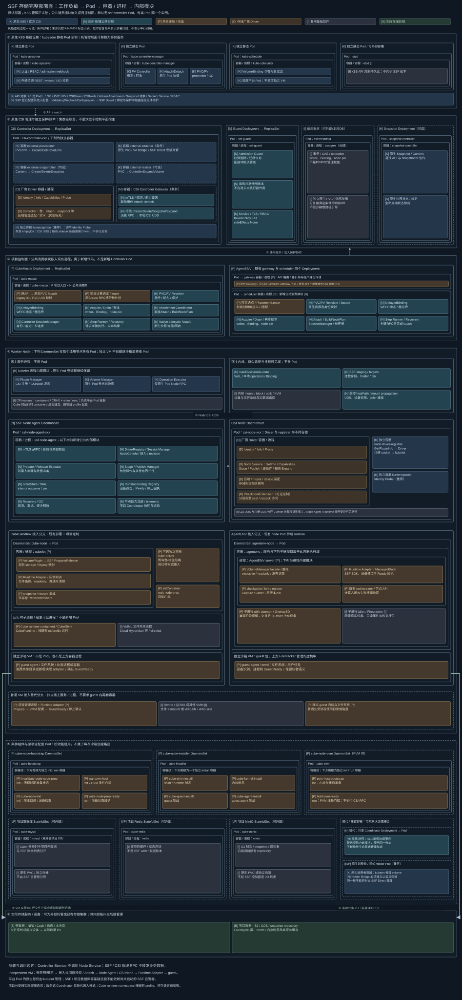

# Kubernetes 管理卷、Substrate 模式直接挂载的沙箱存储框架

新增 [自动卷准备与直接 PVC 实现/部署/验证](22-volume-preparation-implementation.md)：Kubernetes 创建 PVC 后，原 AgentENV 创建接口通过 `volumeMounts[].pvc` 引用。具体通过、未执行和未完成边界以该记录为准。

> 最新设计见 [21：SSF 卷管理与运行时 Adapter](21-ssf-volume-provisioning-and-runtime-adapter-design.md)。自动准备及直接 PVC 的软件增量、部署和验收边界见 [22](22-volume-preparation-implementation.md)。

**目标用户流程只有两步：Kubernetes 创建 PVC → 原 AgentENV 创建沙箱直接引用 PVC。** adapter 分为供卷定制准备、沙箱内部挂载两部分；原 `/volumes` 是可选 facade。[20](20-kubernetes-pvc-agentenv-mount-validation.md) 保留此前实现的绕行验证，不再作为目标操作方案。

**卷管理保留 Kubernetes 原生体系：StorageClass、PVC、PV、供卷、绑定、快照、克隆、扩容和回收。沙箱消费参考 Substrate：创建请求直接驱动 Controller Attach、节点 Stage/Publish 和运行时接入，不创建逐沙箱消费者 Pod，不等待 kubelet 卷调谐。**

框架暂称 SSF（Sandbox Storage Framework）。本次重新设计将双供卷入口收敛为唯一 Kubernetes 管理入口；Substrate 的直接 CreateVolume/DeleteVolume、Actor 专属卷模型和整套控制面不引入。消费协调模块默认嵌入项目现有控制面，无须额外部署 `ssf-controller` Pod。

更新：2026 年 10 月 21 日。公共框架代码位于 [SSF](../SSF/README.md)，已进入实现与验证阶段。实际测试状态见 [实现验证报告](10-implementation-validation.md)，不能将本机单测视为 Linux/VM 性能实测或本轮新增设计已完成。

**AgentENV 接入保留原 Gateway、Scheduler、节点服务和全部原生沙箱生命周期 API。** 公共消费及新增卷准备编排嵌入原 Scheduler，原生 Orchestrator 通过存储插件接入 CSI。先读 [21：本轮设计](21-ssf-volume-provisioning-and-runtime-adapter-design.md)，再读 [16：原生插件](16-agentenvadapter-native-integration-design.md) 与 [17：实施验收](17-agentenvadapter-refactoring-and-validation.md)。12～15 反映既有代码，新增设计的实际完成度以 18 为准。

## 阅读顺序

| 文档 | 重点 |
| --- | --- |
| [SSF 卷管理与运行时 Adapter〔最新设计〕](21-ssf-volume-provisioning-and-runtime-adapter-design.md) | Kubernetes 建卷自动准备；两部分 adapter；PVC 直接引用；Immediate/WFFC、状态/安全/实施边界 |
| [现有项目分析](01-repository-analysis.md) | CubeSandbox v0.7.3、AgentENV v0.2.3 的代码及数据语义；历史源码分析保持不变 |
| [选型与职责边界](02-csi-decision.md) | Kubernetes 管理、Substrate 消费的分工，以及此次收敛的决策 |
| [整体架构与接口](03-framework-design.md) | 模块、请求、状态、执行时序、运行时和故障恢复 |
| [项目接入与验证](04-integration-and-validation.md) | Cube/AgentENV 改造、迁移、PoC 和性能验收 |
| [Kubernetes 生命周期集成](05-kubernetes-integration.md) | Immediate/WFFC、PVC/PV 解析、唯一管理权、删除与原生回收 |
| [Substrate 实现分析](06-substrate-storage-analysis.md) | 当前 Substrate 的原始实现证据；分析文档保持不变 |
| [Substrate 代码复用与实现设计](07-substrate-inspired-implementation.md) | 可复制、需修改、不引入的源码，以及公共包边界 |
| [完整部署与模块归属](08-full-deployment-architecture.md) | 全部相关 Pod、容器、进程，以及原生/新增/项目定制的区分 |
| [软件实施记录](09-implementation-log.md) | 实施顺序、关键修正与环境限制 |
| [实现验证报告](10-implementation-validation.md) | 已执行检查、跳过项及复现命令 |
| [实现覆盖矩阵](11-implementation-coverage.md) | 设计到公共软件模块、测试与项目扩展的映射 |
| [AgentENV 独立适配设计与实现〔原生插件〕](12-agentenvadapter-design-and-implementation.md) | 原生模块、生命周期与必要侵入点 |
| [AgentENV 安装部署手册〔原生插件〕](13-agentenvadapter-installation-and-deployment.md) | 原 Kustomize base 增量 overlay、凭据、渲染与部署边界 |
| [AgentENV 测试方案〔原生插件〕](14-agentenvadapter-real-environment-test-plan.md) | 原生 API 数据语义、真实环境矩阵与测试工具 |
| [AgentENV 最简操作〔原生插件〕](15-agentenvadapter-quick-test.md) | 原生 API 与现有测试工具的快速入口 |
| [AgentENV 原生架构内的 SSF 插件设计〔当前目标〕](16-agentenvadapter-native-integration-design.md) | 原生 API/部署、统一 SPI、调度与模板、pause/resume、Capture/Clone、有限框架优化 |
| [AgentENV 重构、迁移与验收〔实施与验收〕](17-agentenvadapter-refactoring-and-validation.md) | 文件级改造边界、overlay、实施门禁、兼容性/数据/故障矩阵、原型迁移 |
| [已部署环境的逐步场景验证](19-agentenv-native-scenario-validation.md) | 一份笔记贯穿创建、读写、暂停恢复、快照、Fork、模板、扩容和清理 |
| [Kubernetes PVC 导入与挂载验证〔此前实现绕行〕](20-kubernetes-pvc-agentenv-mount-validation.md) | 反映旧代码限制；初始化 Pod/import 不是最新目标流程 |
| [用户指定 K8S CSI 架构参考](assets/K8S-CSI架构分析.md) | 架构与图形样式参考，原文不修改 |

## 架构图

最新两部分 adapter 及准备链见 [21 的关键模块图](21-ssf-volume-provisioning-and-runtime-adapter-design.md#3-关键模块与部署归属)。此前原生消费基线图：[关键模块](figures/agentenv-native-modules.svg) · [原生部署](figures/agentenv-native-deployment.svg) · [创建调用](figures/agentenv-native-calls.svg)，尚未展开新增卷准备模块。



[可编辑 Mermaid](figures/ssf-key-modules.mmd) · [PNG](figures/ssf-key-modules.png) · [部署概览](figures/ssf-deployment.svg) · [调用关系](figures/ssf-module-calls.svg)



[放大 SVG](figures/ssf-full-deployment.svg) · [PNG](figures/ssf-full-deployment.png) · [Mermaid](figures/ssf-full-deployment.mmd) · [部署清单](08-full-deployment-architecture.md)

图中灰蓝 K 表示原生 Kubernetes/官方 CSI，青蓝 N 表示新增公共实现，棕色 P/D 分别表示项目定制和存储 Driver，绿色 B 为后端，灰色虚线框为条件部署。公共模块可以嵌入项目进程；蓝色框不等于新增 Pod。CSI Controller 与 Node 由调用方分别驱动，业务 I/O 不经管理 RPC 转发。

## 最终职责

| 能力 | 唯一负责方 |
| --- | --- |
| 卷定义、StorageClass、PVC/PV、配额及供卷 | Kubernetes API、PV Controller、external-provisioner、厂商 Driver |
| 运行时卷规格与内容准备〔新增设计〕 | SSF 公共准备协调器 + adapter 第一部分；原生供卷后自动构建/校验，无必需 import |
| 后端卷删除 | Kubernetes 原生回收流程；沙箱侧先排空和授权，不直接 DeleteVolume |
| 后端 snapshot/clone、Controller 扩容 | 按需启用的原生快照/供卷/扩容组件；Runtime 另做一致性与 guest 配合 |
| 独立沙箱 WFFC 选点 | 项目调度器 + 公共 DelayedBinding；原生组件继续创建卷并完成绑定 |
| 沙箱使用授权、持久步骤、Attach/Detach | 嵌入现有项目控制面的公共消费协调模块 |
| NodeStage/Publish 及逆操作 | 公共 SSF Node Agent，经本机 UDS 调用厂商 CSI Node |
| 文件共享、虚拟磁盘、guest 就绪 | 各项目 Runtime Adapter，参考 Substrate 分层接入 |
| 使用引用、删除屏障、未知结果恢复 | 全局消费账本、独立准入 Guard、节点 WAL；不建立第二套卷生命周期 |

对外仍可提供项目原有 Volume API，但其 Create/Delete/Snapshot/Clone/Expand 实现必须转换为 Kubernetes 资源操作。`volumeUID` 是稳定的使用索引，PVC/PV 是管理权威，CSI handle 来自真实 PV；不允许通过索引单独创建或删除后端卷。

## 创建沙箱的路径

```text
CreateSandbox(volumes = PVC 引用或已登记 volumeUID)
 → 解析身份/权限/能力；联合计算与存储选点
 → 必要时 WFFC 选点预留、原生供卷/绑定，确认真实 Bound
 → 自动完成/等待 adapter 卷准备；已 Ready 卷复用证明；准备占用释放或原子接续
 → 登记使用引用、writer/node pin；直接 EnsureAttachment
 → 现有创建 RPC 携带受约束 NodeVolumePlan
 → Node Agent 同步 Stage/Publish
 → Runtime Adapter 接入目录或块设备，确认 GuestReady
```

静态 PV+预绑定 PVC 或提前完成的 Immediate PVC 可将供卷移出启动路径；不代表提前固定或 Attach 到 Worker。WFFC 同属首期正式能力：动态卷在首次消费时供卷，静态卷在首次消费时选卷/绑定；绑定后共用直接消费路径。

正常请求主动推进消费步骤，后台执行相同处理器完成恢复、补偿和释放；新增准备协调器通过 PVC watch 自动推进 Immediate 内容准备，WFFC 与首次创建共用同一准备记录。控制面仍需要使用记录和排他保护，但不通过创建 Binding CRD 后等待调谐来触发普通沙箱挂载。watch 不是已就绪卷每次挂载的触发器。

## 性能与兼容范围

优化重点为提前供卷、常驻 Driver/长连接、预先完成能力发现、兼容的 attachment/stage 复用、多卷批量及并行准备。后端真实 Attach、Publish、VMM 与 guest 接入和权威使用授权全部计入端到端延迟，不承诺所有存储都有相同冷启动毫秒值。

Kubernetes 协议与资源兼容不等于自动具备独立 VM 的引用保护。生产使用需完成专用资源范围、默认 Retain、Guard、事务账本和回收屏障；同一后端资源不由 kubelet、external-attacher 与 SSF 同时管理相同消费操作。

CubeSandbox 保持外部卷 Reference/Share；AgentENV 保持可写卷 Capture/Clone、只读共享与层发布约束。存储差异由 Driver 表达，VMM/guest 差异由 Runtime Adapter 表达。纯宿主运行的沙箱节点也可以调用 Kubernetes 管理面；完全没有 Kubernetes API 的独立供卷不在本方案范围。

AgentENV 原生插件当前交付入口：[实现](12-agentenvadapter-design-and-implementation.md)、[部署](13-agentenvadapter-installation-and-deployment.md)、[测试](14-agentenvadapter-real-environment-test-plan.md)、[快速操作](15-agentenvadapter-quick-test.md)、[逐项状态与证据](18-native-integration-implementation-status.md)。保留原 Gateway/Scheduler/节点和 API；旧原型部署已移除。
